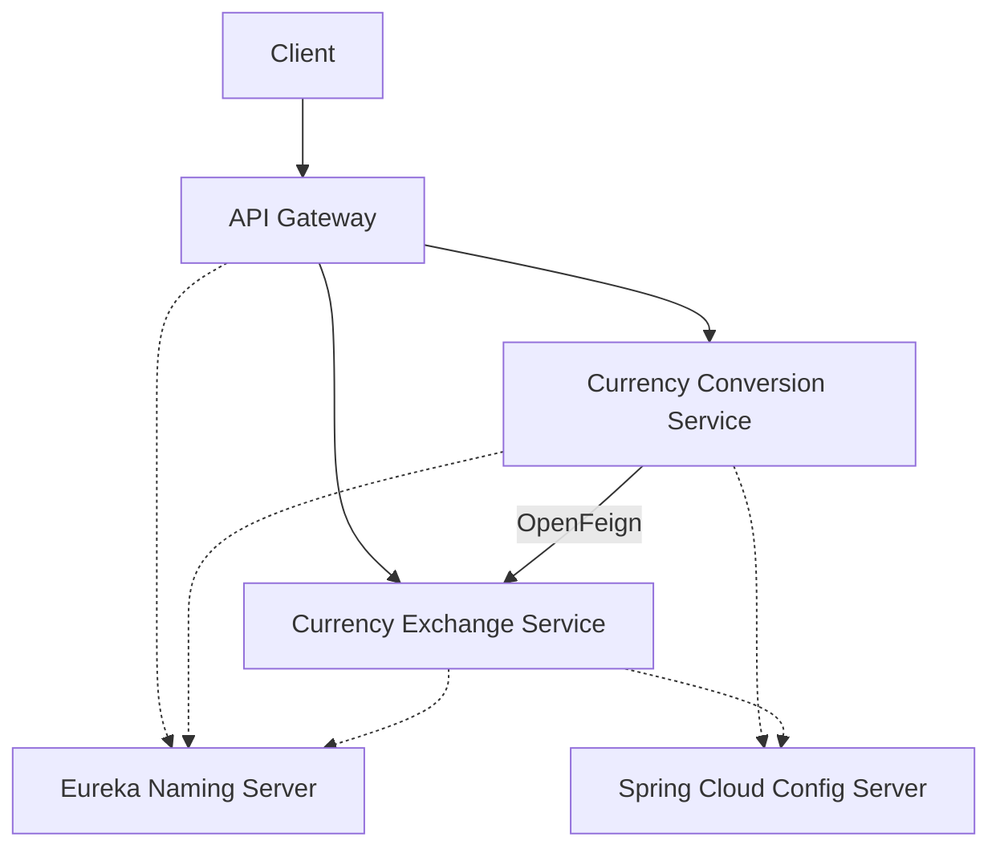
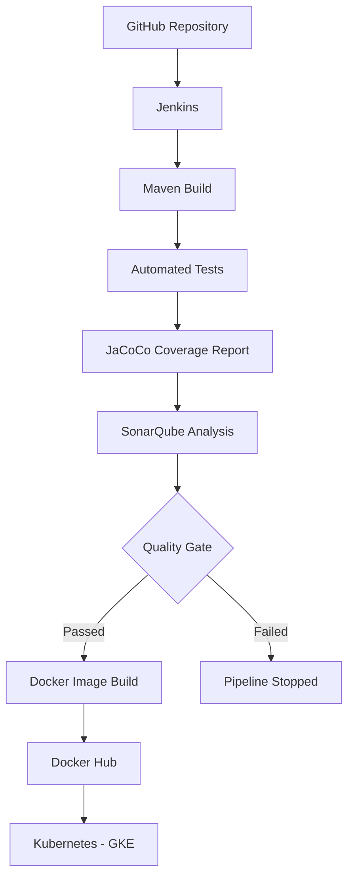

# Currency Conversion Microservices

A distributed microservices application built with Java, Spring Boot, and Spring Cloud, demonstrating backend development, automated testing, containerization, cloud deployment, and CI/CD practices.

## Project Overview

This project demonstrates the design and implementation of a microservices-based currency conversion system.

The application provides currency exchange and currency conversion functionality through RESTful APIs. It incorporates service discovery, centralized configuration, API routing, inter-service communication, fault tolerance, automated testing, and continuous integration and deployment.

The main objective of this project was to gain practical experience in developing, testing, and deploying distributed backend applications using modern software engineering practices.

## System Architecture

## Technologies and Tools

| Category | Technologies |
| --- | --- |
| Programming Language | Java |
| Backend Framework | Spring Boot |
| Microservices | Spring Cloud |
| REST API | Spring Web |
| Service Communication | OpenFeign |
| Service Discovery | Netflix Eureka |
| API Gateway | Spring Cloud Gateway |
| Centralized Configuration | Spring Cloud Config |
| Fault Tolerance | Resilience4j |
| Unit Testing | JUnit, Mockito |
| API Testing | MockMvc |
| Integration Testing | Spring Boot Test |
| Code Coverage | JaCoCo |
| Code Quality | SonarQube |
| Containerization | Docker |
| Container Registry | Docker Hub |
| Container Orchestration | Kubernetes |
| Cloud Platform | Google Kubernetes Engine (GKE) |
| CI/CD | Jenkins |
| Build Management | Maven |
| Version Control | Git, GitHub |

## Microservices and Components

### Currency Exchange Service

- Provides exchange rates between different currencies.
- Exposes RESTful endpoints.
- Processes incoming currency exchange requests.
- Provides exchange rate information to the Currency Conversion Service.

### Currency Conversion Service

- Performs currency conversion calculations.
- Communicates with the Currency Exchange Service using OpenFeign.
- Retrieves exchange rates dynamically.
- Demonstrates communication between independent microservices.

### Eureka Naming Server

- Provides centralized service registration and discovery.
- Enables microservices to discover available service instances dynamically.
- Supports communication between distributed application components.

### API Gateway

- Provides a centralized entry point for client requests.
- Routes incoming requests to the appropriate microservice.
- Simplifies access to the distributed application.

### Spring Cloud Config Server

- Provides centralized configuration management.
- Separates application configuration from business logic.
- Simplifies configuration management across multiple microservices.

### Fault Tolerance

Resilience4j is used to demonstrate fault tolerance and resilience in a distributed microservices environment.

Implemented concepts include:

- Circuit Breaker
- Fallback mechanisms
- Handling service failures
- Improving application resilience

## REST API

The application exposes RESTful APIs for currency exchange and currency conversion operations.

Main functionality:

- Retrieve exchange rates between two currencies.
- Convert a specified amount from one currency to another.
- Access microservices through a centralized API Gateway.
- Exchange data between services using REST-based communication.

## Automated Testing

The project includes automated testing at different levels to verify application functionality and reliability.

### Unit Testing

- Testing individual application components using JUnit.
- Mocking dependencies using Mockito.
- Testing business logic independently.

### REST API Testing

- Testing REST controllers using MockMvc.
- Validating HTTP responses and application behavior.
- Testing positive and negative scenarios.

### Integration Testing

- Testing interactions between application components.
- Verifying application functionality in an integrated environment.

### Code Coverage

JaCoCo is used to generate code coverage reports and evaluate the effectiveness of automated tests.

## Code Quality

SonarQube is integrated into the development workflow to perform static code analysis and identify potential code quality issues.

The code quality process includes:

- Static code analysis.
- Identification of potential bugs and code smells.
- Code coverage analysis.
- Maintainability assessment.
- Quality Gate validation.

Quality Gate validation is used to ensure that configured quality requirements are met during the CI/CD process.

## Docker and Containerization

The microservices are containerized using Docker to provide consistent and portable execution environments.

The containerization process includes:

- Creating Docker images for microservices.
- Building application images.
- Running microservices in isolated containers.
- Publishing Docker images to Docker Hub.
- Preparing containerized applications for Kubernetes deployment.

## Kubernetes and Cloud Deployment

The containerized application was deployed to Google Kubernetes Engine (GKE).

The Kubernetes environment demonstrates:

- Kubernetes Deployments.
- Kubernetes Services.
- Pod management.
- Replica management.
- Internal service communication.
- Application scalability.
- Microservice deployment and troubleshooting.
- External application access through the API Gateway.

## CI/CD Pipeline

Jenkins is used to automate the software build, testing, code quality analysis, and container image creation processes.

The CI/CD workflow combines source code management, automated testing, quality validation, containerization, and cloud deployment.

The workflow demonstrates the integration of backend development with modern DevOps practices.

## Key Features

- Microservices-based architecture.
- RESTful API development.
- Inter-service communication using OpenFeign.
- Dynamic service discovery using Netflix Eureka.
- Centralized configuration management.
- API routing through Spring Cloud Gateway.
- Fault tolerance using Resilience4j.
- Automated unit and integration testing.
- Code coverage analysis using JaCoCo.
- Static code analysis using SonarQube.
- Quality Gate integration.
- Docker-based containerization.
- Kubernetes orchestration.
- Cloud deployment on Google Kubernetes Engine.
- CI/CD automation using Jenkins.

## Key Learning Outcomes

Through this project, I gained practical experience in:

- Designing and developing distributed backend applications.
- Building RESTful microservices using Java and Spring Boot.
- Implementing communication between independent services.
- Managing service discovery and centralized configuration.
- Implementing fault tolerance and resilience mechanisms.
- Writing automated unit and integration tests.
- Evaluating code coverage and software quality.
- Containerizing applications using Docker.
- Deploying microservices to Kubernetes.
- Integrating automated build and testing processes.
- Working with CI/CD pipelines and cloud infrastructure.
- Troubleshooting distributed application environments.

## Project Purpose

This project was developed as a personal hands-on project to strengthen my practical skills in Java backend development, microservices architecture, software testing, DevOps, and cloud-native application deployment.

It demonstrates an end-to-end development workflow, from application development and testing to containerization, quality assurance, and cloud deployment.
